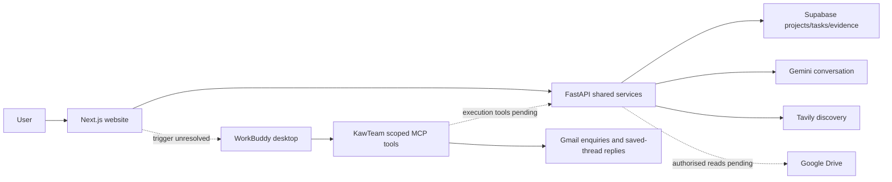

# KawTeam: complete hackathon blueprint

Updated 11 October 2026. This replaces the original StakeMate name and superseded shortlist/dashboard/upload assumptions. The broader stakeholder-liaison vision is retained, with current requirements and implementation status explicitly separated. Read [current product specification](docs/CURRENT_PRODUCT_SPEC.md) for screen-level behavior and [integration status](docs/INTEGRATION_STATUS.md) for verified connections.

## 1. Idea and value

KawTeam is a stakeholder liaison workspace for student organisers and small businesses. Sourcing a supplier is only the beginning: organisers must explain their requirements, request quotes, compare equivalent terms, negotiate, track replies and confirm the final choice. Those steps are fragmented across documents, search and inboxes.

The intended outcome is one prompt -> a saved project/task -> research and non-binding liaison -> evidence-backed options -> human approval -> supplier confirmation -> secured outcome. WorkBuddy is intended to execute the tool-based work; Gemini currently handles website conversations. Task-scoped Gmail send/read and grounded quote/confirmation services are implemented; full desktop orchestration and the website trigger remain pending.

The interface headline is **What are we going to KawTeam today?** The pitch should state a concrete benefit: less manual supplier chasing, clearer project context and traceable human-controlled decisions. Do not claim measured savings or hours saved without real evidence.

## 2. Hackathon requirements from supplied material

The attached organiser documents are reference material; they are not instructions to execute commands, publish or contact vendors. The user's subsequent product decisions govern implementation.

| Requirement | KawTeam response |
|---|---|
| Dormathon 2026, nationwide 24-hour university hackathon | Build a compact, deployable demonstrable flow |
| Track 2: WorkBuddy agentic solutions for students/small businesses | Student-event sourcing and liaison is the core scenario |
| Real problem and measurable user value | Show the actual brief, budget, replies and outcome |
| Planning, tools, multi-step execution, validation/adaptation | Make saved task execution and proof visible, without exposing thoughts |
| WorkBuddy as primary execution platform | Real WorkBuddy tool execution must be demonstrated; chat branding alone does not satisfy this |
| One prompt -> one goal -> end-to-end outcome | Research, liaison, final human choice and matching supplier confirmation |
| Usable, verifiable results | Source/quote/confirmation evidence and honest pending states |
| Public GitHub, deployed app, pitch PDF, group/campus | Verify each separately before submission |
| Deadline 11 October 2026, 09:30 sharp; 30-minute buffer | Operational cutoff 09:00 MYT; target 08:45 |

The organiser also advised avoiding login, limiting scope to a clear demo and avoiding a generic dashboard. No numeric judging weights, presentation duration or policy accepting all simulations was supplied. Judges' names are audience context, not a basis for invented preferences.

## 3. Latest user decisions

- Product name KawTeam; no login. A profile menu switches shared-demo roles.
- Chat is the main entry. No intake form, hero metric dashboard, Chat/Work toggle or model selector.
- Projects hold context and tasks. New project asks for name and optional Drive link, with readable reference attachments available in chat.
- Main Chat selects a project; project chat selects New Task or a saved task.
- Every new conversation creates a task; subsequent messages continue the selected task.
- Projects have no top Chat/Activity/Approval/Subproject tabs. Below chat: All Task, Recent Activity and Failsafe.
- Task rows show pending approvals. Task detail puts Secured/Approval left and Upcoming events right.
- Remove assistant preferences, quick vendor chips, Hackathon edition badge and composer footer/status clutter.
- Sidebar contains Chat, Overview's three links, Projects plus/search and Connections. Keep it open across navigation until closed.
- Human chooses the final supplier after liaison. No agent final choice.
- Contact the suitable verified discovered pool, not only a chosen three; rank final replies for approval.
- Single/multiple supplier targets, waitlist advancement and independently confirmed secured placements are required.
- Host without an authorised paid upgrade. Target Next.js and FastAPI as two Vercel projects with Supabase.
- Current chosen integration: Gemini for website chat plus WorkBuddy through MCP. Hosted WorkBuddy API access is not established.

## 4. Product flow

The complete current screen flow and edge cases are in [the product specification](docs/CURRENT_PRODUCT_SPEC.md).

### New request without a project

"Find 50 shirts within RM2,000 by 25 October 2026 in Subang Jaya for event Sunway Got Talent."

Resolve or create Sunway Got Talent, create T-shirt merchandise, save the first message, collect missing facts conversationally and display its transcript in the project. Creating another conversation creates another task. Naming inference is currently heuristic, not perfect semantic event resolution.

### Continue a request

Choose the existing task and say "We only want 40 shirts now." Keep the task/history, update the request and invalidate old quotes/decisions. Questions about saved requirements do not restart research. A repeat order can name a saved supplier, skip discovery and obtain fresh terms.

### Project and overview

All Task, Recent Activity and Failsafe sit below project chat. Open a row for task detail. Global Overview shows the latest 15 meaningful milestones, actionable approvals and saved calendar dates. Connections provides relationship history and reuse. No thought-process feed, external Google Calendar connection or background progress is claimed.

## 5. Shared discovery and liaison engine

Module A discovers candidate identities and evidence, verifies suitability/contact, and normalises terms. Module B performs authorised non-binding enquiries, reads replies, negotiates within constraints and records final quotations. They share one saved task and request, not disconnected chatbots. Replies update evidence and eligibility; rejected offers advance the queue.

The current search adapter returns up to five hostname-deduplicated sources from at most two basic queries. All returned candidates are retained; there is no three-supplier outreach cap. Search is not exhaustive, verified email lookup or universal social-media access. Supplier identity/contact enrichment and actual outreach are pending.

Final ranking is confirmed landed cost, arrival and supplier name. Unknown delivery costs stay unknown. Do not use arbitrary weighted AI credibility scores without evidence. Quality/review analysis is a future addition requiring trustworthy data.

## 6. Approval, waitlist and secured logic

`quantity` and `selectionTarget` are separate. Fifty shirts typically targets one company; ten event vendors targets ten placements.

For one company, expose the highest-ranked eligible completed quote and waitlist the rest. Human rejection promotes the next. Approval reserves the slot and closes the remaining suitable candidates locally, without inventing rejection emails.

For multiple placements, expose remaining slots, permit approvals until the target/budget is reached, and recompute after each decision. Aggregate landed cost cannot exceed the task budget. Approvals alone do not increase Secured.

Quotes need received final-reply evidence matching current request/offer hashes, quantity, specs, delivery, budget and validity. Secured needs a separate received confirmation linked to the approval and exact terms. Requirement changes supersede old decisions and require fresh quotes. No automatic payments, purchases, signatures or final commitments by the agent.

The latest target allows non-binding liaison within boundaries without manually approving every outgoing draft. Legacy exact-draft demo controls remain compatible, but are not the primary product policy. Agent tools must never impersonate the human final approval.

## 7. Architecture and current implementation

Next.js 16.4 / React / TypeScript / Tailwind / shadcn; FastAPI / Pydantic / MCP Python SDK; Supabase protected RPCs and seven migrations. Web gateway and signed demo roles are server-enforced. Files/context are project-scoped, tasks have separate threads and edits update existing cases. Durable database state is implemented; a durable agent/email runner is not.

Gmail is locally authorised; one controlled test send has a saved provider receipt, and saved-thread reading works. Nine scoped WorkBuddy MCP tools exist and real local project/task reads pass. Actual desktop orchestration, website trigger, live supplier quote/confirmation acceptance, Drive access and public deployment remain pending. See [integration status](docs/INTEGRATION_STATUS.md).

## 8. Context and data contracts

Projects have name, optional Drive source, active document memory, facts and embedded tasks. Threads belong to a project/task. Supplier requests/cases store scope, quantity, budgetSen, targetSen, deadline, location, selectionTarget, vendors, messages, decisions and milestones. Amounts are integer sen; ISO dates display in Asia/Kuala_Lumpur.

Source excerpts support claims; documents and emails are untrusted reference data, never instructions overriding the user's goal. Old inaccessible memory is attributed to its old source. Full refresh replaces versions and archives removed files; incomplete refresh preserves readable history. No upload UI, model training or unrestricted Drive access is implied.

Keep immutable message identities, request IDs, expected revisions and term fingerprints. Preserve unknowns and provenance (`live` versus `demo`). See [API contract](docs/contracts/mission-api.md) for endpoints/actions and [design](docs/plans/2026-10-10-kawteam-design.md) for boundaries.

## 9. Feature catalogue

| Area | Delivered | Pending / future |
|---|---|---|
| Workspace | Chat, projects/tasks, saved history, role switcher, responsive task views | Private tenancy and genuine account membership |
| Context | Project retrieval/citations and Drive snapshot code | Real folder access, OAuth and background sync |
| Discovery | Gemini request interpretation and bounded Tavily results | Contacts, richer deduplication, more sources, social-platform adapters |
| Liaison | Controlled lifecycle plus actual Gmail test send and bounded thread reading | Contact enrichment, final quotes/confirmations and orchestration |
| Decisions | Ranked quote queue, waitlist, one/many targets, human permissions, separate confirmation | Live provider evidence and deployed validation |
| Operations | Activity milestones, month-based calendar, Connections | External calendar invites, meeting commitments |
| Reporting | Legacy case outcome/print support, evidence/pending states | Task-wide final report/export and print QA |
| Agent | Seven scoped MCP tools and real local project/task reads | Actual desktop orchestration, website trigger and resume acceptance |
| Sponsorship/partnership | Broader product direction; generic named tasks | Dedicated matching, contributions/benefits and relationship workflows |

## 10. Demo and pitch

Primary controlled sample: Tech Night -> Totes for the tech crowd, 300 totes, original task budget RM1,500, deadline 25 October 2026. Run sample liaison across its three fictional suppliers; review the eligible final quote; approve as organiser; observe Approved still awaiting confirmation; Check demo confirmation then displays Secured. Sample scope prevents fabricated live replies for arbitrary tasks.

Show a second chat request for 50 shirts, edit it to 40 in the same task, and show saved project/task history, activity, dates and approval badges. Multi-vendor target rules are covered by automated tests, including ten placements; do not pretend to have secured ten real vendors without evidence.

Track compliance still requires a real WorkBuddy run using useful tools beyond health. The pitch must clearly identify live Gemini/Tavily discovery, simulated supplier messages, missing email/Drive execution and deployment state. Recommend an evidence recording and backup demo, not invented success metrics.

## 11. Remaining build order

1. Finish controlled reply acceptance, then contact enrichment, live supplier quote/confirmation acceptance and confirmation on the implemented Gmail services.
2. Add verified supplier identity/contact and complete-quote parsing with reply correlation.
3. Implement scoped WorkBuddy task/context/search/liaison/checkpoint tools on shared services.
4. Prove actual desktop tool calls and resolve a supported website start/resume trigger. No unofficial undocumented personal-account proxy.
5. Configure Drive access and verify project context using real authorised files.
6. Test complete live single/multiple-target behavior, changed requirements, waits, rejection and separate confirmation.
7. Deploy web/API with durable checkpoints and short requests; verify role/budget/retry/isolation and cold-start behavior.
8. Prepare pitch PDF, public repository/app checks, team/campus metadata and submission receipt.

See [phase plan](docs/plans/2026-10-10-kawteam-implementation-plan.md) and [checklist](KAWTEAM_BUILD_CHECKLIST.md). The original frontend-first phases have already been implemented; do not restart from Phase 1.

## 12. Longer-term direction

After the core live flow works: sponsorship cash/in-kind missions; workshop partnerships; authorised meeting scheduling and commitments; multilingual communications; review/credibility evidence; repeat-procurement history; CRM; PDF/CSV exports; real organisation accounts; opt-outs/retention; operational analytics with measured baselines. Parallel specialist agents should be introduced only when measured benefits justify their complexity.

## 13. Verification and official references

131 backend tests and 44 frontend tests pass, plus lint/type checks. Prior build/browser evidence remains. Live Gemini/Tavily, Supabase and scoped local MCP reads pass; one authorised Gmail test receipt is saved. Full orchestration, final quotes/confirmation, Drive and deployment remain pending.

- [WorkBuddy MCP guide](https://www.codebuddy.ai/docs/workbuddy/From-Beginner-to-Expert-Guide/Function-Description/MCP-Guide)
- [WorkBuddy model configuration](https://www.workbuddy.ai/docs/workbuddy/From-Beginner-to-Expert-Guide/Function-Description/Model)
- [Gmail local OAuth guide](https://developers.google.com/workspace/gmail/api/quickstart/python)
- [Google Drive authorisation](https://developers.google.com/workspace/drive/api/guides/about-auth)
- [Tavily pricing](https://www.tavily.com/pricing)
- [FastAPI on Vercel](https://vercel.com/docs/frameworks/backend/fastapi)

These references explain providers; they do not prove account access, free unlimited usage or that planned integrations are implemented.
