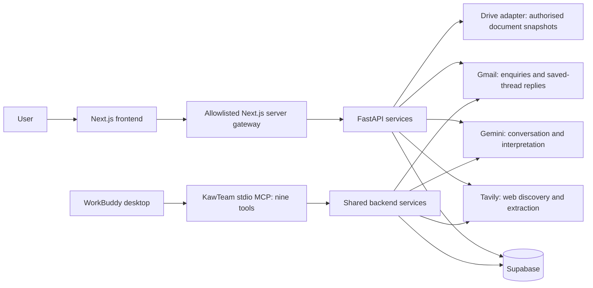

# KawTeam architecture

Updated 11 October 2026. This replaces the old blueprint and implementation plans. The [product specification](CURRENT_PRODUCT_SPEC.md) defines current behaviour; [integration status](INTEGRATION_STATUS.md) separates implemented services from pending connections.

## Problem and outcome

Supplier sourcing spans project documents, search results, emails, negotiation and human decisions. KawTeam keeps that evidence in a project/task workspace so organisers can delegate non-binding liaison while retaining the final choice. The three demonstration use cases are single-supplier merchandise, multiple event exhibitors and a repeat order from an existing supplier.

## Runtime architecture

The Drive adapter needs configured access. There is no website-to-WorkBuddy execution endpoint. Google Calendar synchronisation is a proposed extension, not an existing edge in this runtime diagram.

| Layer | Implementation |
|---|---|
| Frontend | Next.js 16.4, React, TypeScript, Tailwind and shadcn primitives |
| Design | Teal/lime, translucent surfaces, compact typography, official logo/favicon; TeX Gyre Heros licence retained |
| API | FastAPI/Pydantic, allowlisted server gateway, signed shared-demo roles |
| Database | Supabase workspace/record/action tables and seven ordered migrations |
| Providers | Gemini, Tavily and Gmail adapters; optional authorised Drive access |
| Agent interface | Python stdio MCP consumed by WorkBuddy desktop |
| Deployment target | Separate Vercel projects rooted at `apps/web` and `apps/api` |

## Data and execution

Projects hold shared facts, a Drive source and document memory. Tasks hold scoped conversations; supplier cases hold constraints, candidates, quotations, messages, decisions and milestones. Supabase is the source of truth in API mode. Legacy case routes and browser-local demo helpers remain secondary compatibility surfaces.

The user message and task creation commit together. Assistant completion and case updates are transactional. Request IDs, content hashes and expected revisions protect retries and concurrent edits. Requirement changes preserve history but invalidate old commercial terms and decisions. Unknown costs remain unknown; amounts use integer sen and dates display in Asia/Kuala_Lumpur.

A new sourcing request queues bounded outreach. Foreground ticks verify contacts, send non-binding enquiries, read saved threads and interpret replies. Persisted intents and provider IDs distinguish actual sends from drafts. A lease limits concurrent runners, and uncertain sends block automatic retry. WorkBuddy can execute the same scoped steps through MCP.

Final quotations must match the current request and include usable price, scope and delivery evidence. Valid offers are ranked by confirmed landed cost and arrival. Item quantity and supplier/placement target are distinct. Human approval reserves a slot and budget; only a later matching supplier confirmation permits Secured. Agent tools expose no final approval, purchase, payment or binding acceptance.

Documents, web pages and emails are untrusted reference data, not instructions or authority. Credentials stay on the server. Direct public database access is revoked; scoped RPCs validate workspace ownership, role, revision and idempotency. The shared role switcher deliberately does not provide private account authentication.

## Hackathon alignment

The supplied organiser material describes Dormathon 2026 as a nationwide 24-hour hackathon. Track 2 asks agents to understand goals, plan, use tools, collaborate/validate and deliver usable outcomes, with WorkBuddy as the primary execution platform. Demonstrate actual WorkBuddy calls and saved results; website chat branding or coding assistance alone does not establish that execution requirement.

The current compact scope follows the organiser's advice: no login, a clear primary chat experience and a focused demonstrable outcome. No numeric scoring weights or presentation duration were supplied. Required submission items and dates are recorded in the [README](../README.md).

## Remaining extensions

Prioritise real WorkBuddy desktop execution evidence, authorised Drive reads, real supplier acceptance and deployment. Google Calendar is the newly requested one-way extension: upsert saved important dates into an owned calendar, retain stable external event IDs, update changes without duplicates and apply reminder settings. Calendar OAuth and sync code still need implementation.

Longer-term directions include private organisations, unattended jobs, broader discovery, sponsorship/scholarship-specific evaluation, authorised social messaging and richer reporting. These are not current hackathon claims. The [proposed workflow graphic](assets/kawteam-proposed-workflow.png) illustrates the target, including pending WorkBuddy triggering and Calendar sync.
