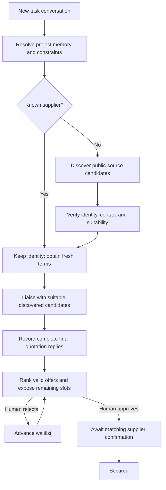

# KawTeam: current product specification

Updated 11 October 2026, Asia/Kuala_Lumpur. This is the current product source of truth. The user's latest decisions supersede older plans. [Integration status](INTEGRATION_STATUS.md) separates working functionality from pending connections; its remaining-work checklist records unfinished acceptance steps.

## Product and purpose

KawTeam helps student organisers and small businesses source and liaise with suppliers or other stakeholders. The user describes an outcome in chat; project memory provides context; the intended agent researches, communicates and negotiates; the organiser makes the final choice. A supplier is secured only after the approved terms receive a matching supplier confirmation.

The main headline is **What are we going to KawTeam today?**, without a logo/emblem above it. The product is chat-first, with focused task management below the project composer. Procurement is the primary implemented scenario. Sponsorship, scholarships, partnerships and meeting coordination remain broader product directions, not claims of completed specialist workflows.

## Navigation and design

Use the exact light material tokens, five aurora gradients and TeX Gyre Heros font files from [the supplied design reference](https://github.com/Waaayneee/SatuHati), with its font licence retained. Deep teal `#00545f`, lime `#d6fb00`, pale lime `#ecffb6`, translucent white fills and matched shadows form the shared component theme. Headings, names and active labels use the reference's 700 weight; body/meta use 400. Keep the original compact font sizes, with the centred project title slightly larger (34px desktop, 28px mobile). Approval, calendar and connection views use the reference component materials without restoring its old flow. The official wordmark and stationary hamburger share a centre line, Overview's three links each have an icon, and the bright brand icon appears in the browser tab. Do not restore generic metric cards, a login screen, duplicate creation controls, a model picker or assistant-preference controls.

Recent Activity starts directly with the table column headings, without its duplicate inner title/description/count block. Global Approval uses reference-style review cards, only Approval Needed/Approved filters, no latest-email preview, no View summary button and no Return action; organiser decisions still use the current final-supplier workflow. Connections starts with search and vendor cards, without a duplicate inner heading, description or count, and retains saved relationship/history dialogs. Calendar uses a smaller standalone glass month view with the legend directly underneath and agenda cards alongside it; the extra month/Your schedule heading is omitted. Dates are grouped per project and day, at most three summary cards per day, with all underlying dates available in a detail dialog. Month filtering, upcoming/past semantics and important-date red dots are retained; grouping never deletes saved data.

The top rail contains only a stationary hamburger that toggles the sidebar from the same screen position; separate sidebar close buttons are removed. Its three lines retain their hamburger shape and subtly change width, with a background that blends into the opening sidebar; reduced-motion preferences disable the transition. Breadcrumbs, brand repetition, profile chip and page eyebrows are removed. The profile switcher lives at the bottom of the sidebar. The hamburger starts closed. Once opened, it stays open across navigation until the user closes it; a full reload starts closed. Navigation and Escape used to dismiss a dialog/menu do not close the sidebar. The sidebar contains:

- **Chat**: the main entry page.
- **Overview**: sidebar-only links for Recent Activity, Approval and Calendar. Do not repeat those navigation tabs inside overview pages.
- **Projects**: scrolling project names, a plus for creation and a search icon for filtering. This is the permanent new-project action; an empty project picker also offers Add a project.
- **Connections**: previously contacted or selected suppliers and their saved relationship history. This replaces Vendor Library. Provider configuration is not a navigation page.

There is no login. The profile menu selects Organiser, Teammate or Observer in a deliberately shared hackathon workspace. Backend permissions still apply, but anyone can choose the demo organiser profile; this is not private multi-account authentication.

## Project creation and memory

Creation asks for a project name and optional Google Drive folder/document link. Chat also accepts readable reference files (PDF, DOCX, XLSX, TXT, Markdown and CSV), up to three files and 3 MB combined. Files are extracted before the assistant responds and saved with task scope. Task attachment facts do not become shared project facts, including during Drive sync.

Project memory stores authorised extracted content, source identities and derived facts in Supabase. A selected task shares its parent project's memory but has its own conversation and supplier request. Relevant excerpts and document citations are provided to Gemini; this is stored/retrieved context, not model training or access to the user's whole Drive.

Drive ingestion code exists, but neither supported Drive credential is configured. A saved link alone cannot read a private folder. Current credential routes are a Drive API key for publicly accessible content or a service account with explicit reader access to a private folder. Google user OAuth and background folder syncing are not implemented.

## Main Chat

The main composer selects a **project**, not an AI model. Its Drive-link icon is visible until the selected project has a saved Drive link, and is available before a project is chosen. A separate paperclip icon stages removable file references. Staged Drive links become shared project context; file references remain with the task. Sending a new conversation creates a task in that project. Without a selection, the backend resolves a named existing project or creates one from the prompt, then saves the task and initial message transactionally.

Example: "Find 50 shirts within RM2,000 by 25 October 2026 in Subang Jaya for event Sunway Got Talent." The backend uses or creates Sunway Got Talent and creates a task such as T-shirt merchandise. The resulting conversation opens in that project with its task selected. Research and non-binding enquiries proceed with available context. Unknown quantity remains unknown and enquiries request minimum quantities/pricing tiers; unknown delivery destination is omitted. An absent deadline defaults to a provisional 14 days and is recorded as an assumption. Truly necessary unresolved facts appear in Failsafe rather than blocking the initial chat.

An explicit event/project name is preserved. Otherwise new projects receive concise purpose-based names such as T-shirt Sourcing, Catering & Food or Venue Sourcing, rather than copied prompts. Project-name and task-name inference currently use bounded heuristics. Do not promise perfect interpretation of every ambiguous event reference. Retries with the same request identity must not create duplicate projects, tasks or messages.

## Project Chat and task list

Opening a project starts directly at its chat composer. The project title is centred and shows no Sample badge, even for prepared demo projects. The slogan is **Just KawTeam it!**, at 22px desktop and 20px mobile, smaller than the project title; omit the Start a task description and visible Message KawTeam label while preserving an accessible composer name. Remove the former top Chat / Recent Activity / Approval / Subproject tabs. The selector defaults to **New Task** and can choose an existing task.

- New Task + a request starts a new task conversation.
- Selecting a saved task expands its transcript and continues that task.
- A follow-up question does not create a task or invalidate terms.
- A changed requirement updates the existing request and invalidates old commercial terms and decisions.
- The same unchanged budget or quantity is not a requirement change.

Example continuation: "We only want 40 shirts now." This updates the selected 50-shirt task, retains its history and requires fresh quotes. It does not create a second supplier request or reuse the previous price.

Below the composer, show **All Task**, **Recent Activity** and **Failsafe** with an unresolved-count badge. Failsafe appears only while the project has open issues; resolving the last issue removes the tab and returns its panel to All Task. Failsafe groups last-resort task attention items and accepts a focused reply in the existing task conversation. Optional missing initial destination and ordinary reply waits do not trigger attention. Unknown quantity does; final offers cannot be approved without confirmed scope and fit. All Task uses row boxes, not a data table. Each row links to task details and shows the number of actionable supplier approvals. Tasks replace optional Subprojects in the product vocabulary. Earlier project-wide conversations and legacy case requests remain resumable as tasks.

The user prompt appears immediately with an accessible Thinking indicator. Replies state actual sourcing progress without repeating approval reminders. Later chat updates count recorded current-request messages and replies; internal reasoning is never shown as activity.

## Task page

Show the task title and Continue conversation action. Desktop uses roughly 70% left content / 30% right dates; mobile stacks the columns.

The left side contains:

1. **Secured**: confirmed suppliers and secured/target count. Approval alone is not confirmation.
2. **Approval**: ranked supplier rows with Approval needed, Waitlist, Approved, Secured, Declined, Not selected or terms/liaison-pending states.

The right side contains **Upcoming events**: task deadlines, relevant proposed/confirmed delivery dates and quote expiries that still matter. Dates must come from saved records, not invented scheduling.

Supplier review opens a concise summary of scope, landed cost, delivery, conditions and final replies. Keep detailed evidence available without placing raw email headers or a full email conversation in the primary approval modal. Each supplier row and its approval dialog have a small history icon opening the saved sent/received email timeline for that supplier and task, including prior revisions. Subjects, timestamps and message bodies are plain text; missing history is clearly empty and demo messages are labelled. Only the organiser can approve/reject. Continue conversation returns to the project with the task selected.

## Supplier workflow and final control

The diagram is the target full workflow. Task-scoped non-binding Gmail enquiries and saved-thread reply ingestion now exist; grounded quote/confirmation guards are implemented and tested. Actual commercial acceptance and complete WorkBuddy orchestration/trigger remain pending.

Do not pick three candidates and contact only those. Retain every discovered candidate for verification; the target is to contact the suitable verified pool, then rank final replies for human approval. Search is bounded, not an exhaustive census of every company. The current Tavily adapter runs at most two basic queries, returns at most five deduplicated source candidates and does not verify their email addresses, prices or availability. The five-result retrieval bound is separate from the removed three-supplier outreach policy. Current hostname deduplication can merge distinct businesses on a shared social platform and needs improvement for broader sourcing.

Public social content may be discoverable through web search, but private groups, logged-in feeds and social DMs are not connected. Search results do not grant messaging access.

The latest target policy allows non-binding enquiries and negotiation within the user's constraints without a human checkpoint for every draft. Human approval is required at final supplier selection, after usable final replies. Existing exact-message approval machinery belongs to the legacy controlled flow; it must not redefine the new primary experience.

## One supplier versus multiple placements

`quantity` counts items; `selectionTarget` counts suppliers/placements. Fifty shirts normally requires one supplier. Ten event vendors requires ten placements. Numeric target extraction currently supports vendor/stallholder/exhibitor/partner/sponsor/scholarship wording with a 1-100 bound; specialist scholarship/sponsor evaluation is future work.

- One supplier: the highest-ranked eligible final quote is actionable, others wait. Rejecting it promotes the next eligible offer. Approving it reserves the slot; remaining candidates are marked not selected locally.
- Multiple suppliers: expose up to the remaining target slots; keep the rest waiting. Each approval reserves a slot and consumes the aggregate task budget. Recompute after each decision and never exceed the target or total budget.
- Closing the queue does not mean rejection emails were sent.
- Approved placements still await supplier confirmation. No purchase, payment or signature is performed.

Current ranking is explainable and deterministic: confirmed landed cost, arrival date, then supplier name. It is not an opaque AI score or a guarantee about supplier quality.

## Terms and evidence

Money uses integer sen; unknown shipping is `null`, never an assumed zero. Final quotes need matching scope, quantity, specs, budget, arrival and validity. Request and offer fields form a terms hash. Only a received final-quote record matching that hash can enter the ready queue.

An approval is tied to its current terms. Secured needs a distinct received commitment-confirmation record referencing that supplier, approval and terms hash. Missing proof presents as approved, never secured. Requirement edits invalidate current quotes and decisions, preserving superseded history. A previously used supplier retains identity, not old commercial terms.

## Overview, calendar and connections

Recent Activity displays at most 15 saved milestones across projects, with row dialogs for details. Exclude thought processes, parsing, setup, draft edits and step-by-step internal planning. Contact counts derive from recorded sends; a discovered candidate is not a contacted supplier. Demo activity remains labelled.

Overview Approval has **Approval Needed** and **Approved**, not All checkpoints. Its cards summarise ready supplier decisions and quoted terms without a latest-email preview or View summary button. Open in project navigates to the matching task and automatically opens that supplier approval; closing it keeps it dismissed. Its history icon opens the full saved email conversation. Organisers can approve the specific ready supplier directly; other roles cannot. The sidebar badge counts actionable approvals; it does not count every waitlisted candidate. Approved history can include secured placements while task details retain the distinction.

Calendar uses red dots for saved important dates. Upcoming and Past lists reflect the displayed month and optional selected day. Changing month resets the day filter. Today remains upcoming. Past dates do not mean unfinished work completed. The sidebar counts distinct upcoming saved dates. The website calendar is implemented. One-way Google Calendar synchronisation and reminders are requested but not implemented; enabling the API alone does not connect the app. No automatic external invitation or continuous agent scheduler exists.

Connections includes suppliers with recorded communication or a legacy explicit selection, with controlled provenance retained. Merely finding a website or drafting a message does not establish a relationship. A fresh-request shortcut can reuse a supplier without discovery but still requires fresh terms.

## Implementation boundary

See [architecture](ARCHITECTURE.md) for services and data flow, [API contract](contracts/mission-api.md) for endpoints and [integration status](INTEGRATION_STATUS.md) for credentials, verified evidence and remaining work. Website conversations currently use Gemini; WorkBuddy consumes KawTeam tools through MCP and cannot yet be automatically launched from a website prompt. Google Calendar is a planned integration.

## Scope and non-goals

Keep no login, no separate procurement/upload page, no assistant-preference button, no top project tabs and no optional Subproject feature. No agent final choice, checkout, payment, signature, fabricated supplier confirmation, fabricated savings or silent social messaging. Real private multi-account access, verified social integrations, automatic background Drive sync and external calendar invites are future features.

## Automatic website outreach

Chat supplier requests now persist an authorised task-scoped outreach queue. The visible website runs one bounded step approximately every 15 seconds: verify a public supplier business contact, send a non-binding enquiry, sync saved Gmail threads, interpret a current reply, or request missing/revised terms. Only a literal address from the supplier's own site is used, with grounded service evidence; ambiguous contacts and provider failures remain visible on the task. All discovered candidates stay in the pool; unrelated sources are not emailed.

Email receipts, request hashes, deterministic send IDs, compare-and-swap writes and a 180-second step lease prevent duplicate/concurrent sends. A pause instruction disables further steps; asking to view contact details does not authorise sends. Enquiries stop for unselected suppliers when the approved target is filled. Human supplier selection remains in KawTeam. A later matching confirmation can mark an approved supplier secured; the runner does not send orders or binding acceptance.

Existing tasks are not silently enrolled: continue that task and say `Email the suppliers` or `Start outreach`. New or edited sourcing requests queue outreach automatically, unless the user asks for research only. Keep KawTeam open to advance website ticks; a permanently running hosted worker is not implemented. WorkBuddy can call `kawteam_outreach_step` for the same authorised task, but this does not give the website an inbound WorkBuddy API. Reconnect desktop MCP to discover the ninth tool.

Current provider evidence and acceptance gaps are maintained in [integration status](INTEGRATION_STATUS.md), rather than inferred from task labels or configured keys.
