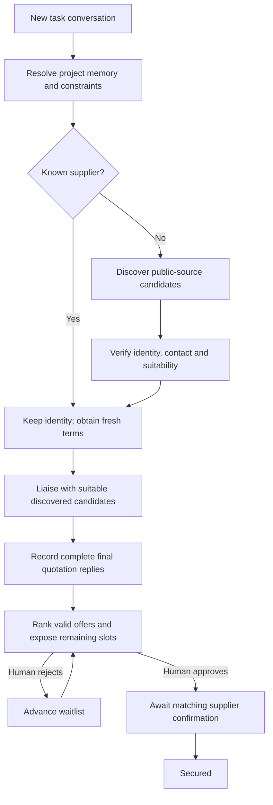

# KawTeam: current product specification

Updated 11 October 2026, Asia/Kuala_Lumpur. This is the current product source of truth. The user's latest decisions supersede older plans. [Integration status](INTEGRATION_STATUS.md) separates working functionality from pending connections; [build checklist](../KAWTEAM_BUILD_CHECKLIST.md) records remaining work.

## Product and purpose

KawTeam helps student organisers and small businesses source and liaise with suppliers or other stakeholders. The user describes an outcome in chat; project memory provides context; the intended agent researches, communicates and negotiates; the organiser makes the final choice. A supplier is secured only after the approved terms receive a matching supplier confirmation.

The main headline is **What are we going to KawTeam today?** The product is chat-first, with focused task management below the project composer. Procurement is the primary implemented scenario. Sponsorship, scholarships, partnerships and meeting coordination remain broader product directions, not claims of completed specialist workflows.

## Navigation and design

Use a light neutral canvas, deep teal `#00545f`, restrained lime `#d6fb00` and pale lime `#ecffb6`. Keep Jakarta typography, generous spacing, clear hierarchy, row-based task lists and consistent shadcn dialogs/dropdowns/calendar. Do not restore generic metric cards, a login screen, duplicate creation controls, a model picker or assistant-preference controls.

The hamburger starts closed. Once opened, it stays open across navigation until the user closes it; a full reload starts closed. The sidebar contains:

- **Chat**: the main entry page.
- **Overview**: sidebar-only links for Recent Activity, Approval and Calendar. Do not repeat those navigation tabs inside overview pages.
- **Projects**: scrolling project names, a plus for creation and a search icon for filtering. This is the permanent new-project action; an empty project picker also offers Add a project.
- **Connections**: previously contacted or selected suppliers and their saved relationship history. This replaces Vendor Library. Provider configuration is not a navigation page.

There is no login. The profile menu selects Organiser, Teammate or Observer in a deliberately shared hackathon workspace. Backend permissions still apply, but anyone can choose the demo organiser profile; this is not private multi-account authentication.

## Project creation and memory

Creation asks for a project name and optional Google Drive folder/document link. Files are not uploaded through the current product UI. Existing upload endpoints and legacy documents remain compatible internally.

Project memory stores authorised extracted content, source identities and derived facts in Supabase. A selected task shares its parent project's memory but has its own conversation and supplier request. Relevant excerpts and document citations are provided to Gemini; this is stored/retrieved context, not model training or access to the user's whole Drive.

Drive ingestion code exists, but neither supported Drive credential is configured. A saved link alone cannot read a private folder. Current credential routes are a Drive API key for publicly accessible content or a service account with explicit reader access to a private folder. Google user OAuth and background folder syncing are not implemented.

## Main Chat

The main composer selects a **project**, not an AI model. Sending a new conversation creates a task in that project. Without a selection, the backend resolves a named existing project or creates one from the prompt, then saves the task and initial message transactionally.

Example: "Find 50 shirts within RM2,000 by 25 October 2026 in Subang Jaya for event Sunway Got Talent." The backend uses or creates Sunway Got Talent and creates a task such as T-shirt merchandise. The resulting conversation opens in that project with its task selected. Missing essential facts are clarified in chat, not a procurement form.

Project-name and task-name inference currently use bounded heuristics. Do not promise perfect interpretation of every ambiguous event reference. Retries with the same request identity must not create duplicate projects, tasks or messages.

## Project Chat and task list

Opening a project starts directly at its chat composer. Remove the former top Chat / Recent Activity / Approval / Subproject tabs. The selector defaults to **New Task** and can choose an existing task.

- New Task + a request starts a new task conversation.
- Selecting a saved task expands its transcript and continues that task.
- A follow-up question does not create a task or invalidate terms.
- A changed requirement updates the existing request and invalidates old commercial terms and decisions.
- The same unchanged budget or quantity is not a requirement change.

Example continuation: "We only want 40 shirts now." This updates the selected 50-shirt task, retains its history and requires fresh quotes. It does not create a second supplier request or reuse the previous price.

Below the composer, show only **All Task** and **Recent Activity**. All Task uses row boxes, not a data table. Each row links to task details and shows the number of actionable supplier approvals. Tasks replace optional Subprojects in the product vocabulary. Earlier project-wide conversations and legacy case requests remain resumable as tasks.

## Task page

Show the task title and Continue conversation action. Desktop uses roughly 70% left content / 30% right dates; mobile stacks the columns.

The left side contains:

1. **Secured**: confirmed suppliers and secured/target count. Approval alone is not confirmation.
2. **Approval**: ranked supplier rows with Approval needed, Waitlist, Approved, Secured, Declined, Not selected or terms/liaison-pending states.

The right side contains **Upcoming events**: task deadlines, relevant proposed/confirmed delivery dates and quote expiries that still matter. Dates must come from saved records, not invented scheduling.

Supplier review opens a concise summary of scope, landed cost, delivery, conditions and final replies. Keep detailed evidence available without placing raw email headers or a full email conversation in the primary approval modal. Only the organiser can approve/reject. Continue conversation returns to the project with the task selected.

## Supplier workflow and final control

This diagram is the target live workflow. The UI, saved state and controlled supplier lifecycle are implemented. Real non-binding liaison, email reply processing and WorkBuddy execution are not implemented yet.

Do not pick three candidates and contact only those. Retain every discovered candidate for verification; the target is to contact the suitable verified pool, then rank final replies for human approval. Search is bounded, not an exhaustive census of every company. The current Tavily adapter runs at most two basic queries, returns at most five deduplicated source candidates and does not verify their email addresses, prices or availability. The five-result retrieval bound is separate from the removed three-supplier outreach policy. Current hostname deduplication can merge distinct businesses on a shared social platform and needs improvement for broader sourcing.

Public social content may be discoverable through web search, but private groups, logged-in feeds and social DMs are not connected. Search results do not grant messaging access.

The latest target policy allows non-binding enquiries and negotiation within the user's constraints without a human checkpoint for every draft. Human approval is required at final supplier selection, after usable final replies. Existing exact-message approval machinery belongs to the legacy controlled flow; it must not redefine the new primary experience.

## One supplier versus multiple placements

`quantity` counts items; `selectionTarget` counts suppliers/placements. Fifty shirts normally requires one supplier. Ten event vendors requires ten placements. Numeric target extraction currently supports vendor/stallholder/exhibitor/partner/sponsor/scholarship wording with a 1-100 bound; specialist scholarship/sponsor evaluation is future work.

- One supplier: the highest-ranked eligible final quote is actionable, others wait. Rejecting it promotes the next eligible offer. Approving it reserves the slot; remaining candidates are marked not selected locally.
- Multiple suppliers: expose up to the remaining target slots; keep the rest waiting. Each approval reserves a slot and consumes the aggregate task budget. Recompute after each decision and never exceed the target or total budget.
- Closing the queue does not mean rejection emails were sent.
- Approved placements still await supplier confirmation. No purchase, payment or signature is performed.

Current ranking is explainable and deterministic: confirmed landed cost, arrival date, then supplier name. It is not an opaque AI score or a guarantee about supplier quality.

## Terms and evidence

Money uses integer sen; unknown shipping is `null`, never an assumed zero. Final quotes need matching scope, quantity, specs, budget, arrival and validity. Request and offer fields form a terms hash. Only a received final-quote record matching that hash can enter the ready queue.

An approval is tied to its current terms. Secured needs a distinct received commitment-confirmation record referencing that supplier, approval and terms hash. Missing proof presents as approved, never secured. Requirement edits invalidate current quotes and decisions, preserving superseded history. A previously used supplier retains identity, not old commercial terms.

## Overview, calendar and connections

Recent Activity displays at most 15 saved milestones across projects, with row dialogs for details. Exclude thought processes, parsing, setup, draft edits and step-by-step internal planning. Contact counts derive from recorded sends; a discovered candidate is not a contacted supplier. Demo activity remains labelled.

Overview Approval has **Approval Needed** and **Approved**, not All checkpoints. Its rows summarise ready supplier decisions and route to the owning task via Open in project. The sidebar badge counts actionable approvals; it does not count every waitlisted candidate. Approved history can include secured placements while task details retain the distinction.

Calendar uses red dots for saved important dates. Upcoming and Past lists reflect the displayed month and optional selected day. Changing month resets the day filter. Today remains upcoming. Past dates do not mean unfinished work completed. The sidebar counts distinct upcoming saved dates. There is no Google Calendar connection, automatic external invitation or continuous agent scheduler.

Connections includes suppliers with recorded communication or a legacy explicit selection, with controlled provenance retained. Merely finding a website or drafting a message does not establish a relationship. A fresh-request shortcut can reuse a supplier without discovery but still requires fresh terms.

## Technical implementation

| Layer | Current implementation |
|---|---|
| Frontend | Next.js 16.4, React, TypeScript, Tailwind, existing shadcn primitives |
| Backend | FastAPI/Pydantic, signed shared-demo profiles, server gateway |
| Persistence | KawTeam Supabase; seven additive migrations, scoped RPCs, revisions and retry protection |
| Conversation | Gemini adapter; live reply through the website verified |
| Discovery | Tavily adapter; live public-source results verified |
| Project memory | Stored extraction/retrieval and Drive adapter; actual Drive reads await credentials |
| WorkBuddy | Desktop custom MCP configured; one health tool; execution tools/trigger still missing |
| Email | Controlled fictional supplier messages only; Gmail OAuth/provider not built |
| Hosting | Two Vercel projects planned, apps/web and apps/api; public deployment not verified |

The Next.js server forwards allowlisted requests to FastAPI. Gateway/database/session secrets are server-only. Supabase tables deny direct public access; private credential-gated RPCs enforce ownership, roles and transactional writes. Seven migrations include atomic task starts, in-place case/chat completion and preservation of earlier general threads.

Task records belong to projects; task threads are separate; supplier cases carry project/task IDs. Legacy API/case routes and browser-local demo helpers remain for compatibility. The live API mode uses Supabase as the source of truth.

## WorkBuddy and Gmail decisions

The team chose **Gemini for website chat plus WorkBuddy through MCP** after personal Google-sign-in access did not establish Enterprise API access. WorkBuddy consumes KawTeam tools; adding our MCP does not make the website call WorkBuddy. A supported API/SDK or verified bridge/trigger is still needed for website-initiated agent runs. Do not claim an always-on desktop agent on Vercel.

The user supplied a WorkBuddy screenshot showing 2,350 credits. Actual remaining balance, expiry and workflow consumption must be checked in that account. Credits are not API credentials and are not evidence that Enterprise API usage is included.

The next integration is Gmail sending and reply reading. Personal Gmail is possible; a dedicated sender is recommended. Use Google OAuth, not a Gmail password. The user supplied `Downloads/Email API.json`; its Desktop-app OAuth client format and Google endpoints were verified without displaying credentials. Sender consent, OAuth token, enabled API and live Gmail access are not yet verified. Public-deployment authorisation and durable reply execution need their own validation.

## Scope and non-goals

Keep no login, no exposed upload form, no assistant-preference button, no top project tabs and no optional Subproject feature. No agent final choice, checkout, payment, signature, fabricated supplier confirmation, fabricated savings or silent social messaging. Real private multi-account access, verified social integrations, automatic background Drive sync and external calendar invites are future features.

## Verification and completion boundary

Latest recorded verification: 71 backend tests, 43 frontend tests, Ruff, TypeScript and ESLint passed. Production build and saved-flow browser checks passed before this documentation refresh. Coverage includes tasks/retries/isolation, in-place edits, 1/10 placement queues, roles, stale terms, budget, confirmation evidence and responsive layouts. Live Gemini/Tavily checks passed; Supabase transactions and MCP health transport were verified. Temporary QA projects were removed and sample mutations restored.

The current application is not a complete autonomous supplier-liaison system. Completion still needs Gmail authorisation/provider, verified contacts and replies, WorkBuddy execution/trigger, actual Drive reads, deployed end-to-end testing and submission materials. See [integration status](INTEGRATION_STATUS.md) for the next inputs and [implementation plan](plans/2026-10-10-kawteam-implementation-plan.md) for build order.
