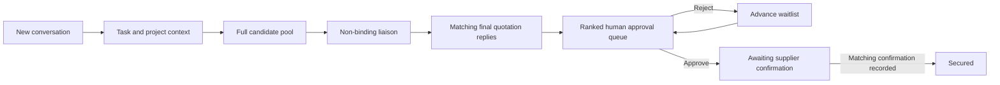

# Task conversations checkpoint

11 October 2026. This supersedes the earlier project tabs, optional subprojects and capped shortlist workflow. The latest user requirements are reflected in the blueprint amendment, README and checklist.

## Project and task flow

Main Chat retains its project picker. A new conversation starts a task in the selected or named existing project, or creates a project using the event name in the prompt. The initial task and message are saved transactionally. Deterministic request/task identities keep retries from creating duplicates.

Projects open directly to chat with **New Task** selected. Choosing a task expands its saved conversation. Follow-up questions stay in the same task; edits update its procurement request rather than creating a second request. The only project tabs are **All Task** and **Recent Activity**, below the composer. Task rows show pending supplier approvals and link to task details. Saved legacy cases and earlier general project conversations remain accessible without removing their original records.

Task detail has Secured and Approval in the wider left column, and Upcoming events in the narrower right column. On mobile the columns stack. Continue conversation returns to the project chat with that task selected. Important dates include the task deadline, relevant delivery dates and pending quote expiry. The global calendar also derives those dates from the saved task state.

## Supplier lifecycle

Every discovered candidate is retained for verification and liaison; saved shortlist preferences no longer impose a three-supplier cap. Public source results are provisional and do not claim verified contacts, prices or outreach. Research provider retrieval bounds remain separate from the candidate pool policy.

`selectionTarget` is independent of item `quantity`: 50 shirts normally needs one supplier; ten event vendors needs ten placements. Final quotation messages must match a hash of the current request and supplier terms, and satisfy scope, budget, specifications, delivery and validity. Suitable offers are ranked by landed cost, arrival and supplier name. Only the remaining slot count is actionable; others wait. Rejection advances the queue. Once the target is occupied, other suitable candidates are marked not selected locally. No rejection email is invented.

Only organisers approve/reject placements. Approval never marks a supplier secured. Secured requires a separate received confirmation with the matching approval ID and terms hash. Requirement edits clear current quotes and approvals and retain previous decisions as superseded history. Unchanged facts and ordinary questions do not invalidate terms.

The original tote sample has an explicit **Run sample liaison** action covering all three saved suppliers in two simulated rounds. **Check demo confirmation** records a separate simulated confirmation only after approval. Both remain labelled as demo and are restricted to the original sample scope; they cannot fabricate live supplier confirmation or run on arbitrary requests.

## Persistence and access

Two additive scoped migrations provide transactional task start, revision-aware case/chat completion and safe legacy conversation copying. All seven migrations are applied to the connected KawTeam Supabase project. Existing role checks, private backend credentials, revision conflict checks and idempotency remain active. No login, additional account flow, paid provider or deployment was introduced.

## Verification

Verification completed against the production preview at localhost:3000: **43 frontend tests and 71 backend tests passed**, along with TypeScript, ESLint, Ruff and the Next.js production build. Read-only project layout and chat/overview regression browser checks passed. Tests cover task naming/retry, selected-task follow-ups, requirement changes, isolation, legacy history, post-liaison ranking, one/multiple slots, ten approvals, aggregate budget, stale terms, confirmation evidence and role restrictions.

The full browser acceptance passed against the production preview: named project creation, separate tasks, quantity edits in place, saved history/reload, task/global approval, rejection/waitlist advancement, independent confirmation, role restrictions and responsive widths of 390, 768 and 1280 pixels. The opt-in database check passed for simultaneous task starts, retries, observer rejection, legacy history preservation and atomic in-place case/chat updates. The original tote sample was restored, and labelled QA projects were removed; the two original projects remain.

Use `npm run test:e2e` for read-only task layout checks. Use `tests/live_task_browser.py` and `tests/live_task_database.py` for the opt-in saved-data checks; their output identifies disposable QA projects. See README for commands. Screenshots stay ignored under `apps/web/test-results/`.

## Live integration status

The UI, persistence and decision lifecycle are implemented. Real autonomous research/liaison still requires configured AI/search, verified supplier contacts and an email execution provider. WorkBuddy remains deferred at the user's request. A Gemini/Tavily connection alone does not send email or receive supplier confirmation. Drive permissions are still required for actual document ingestion. No external supplier message was sent during this work.
