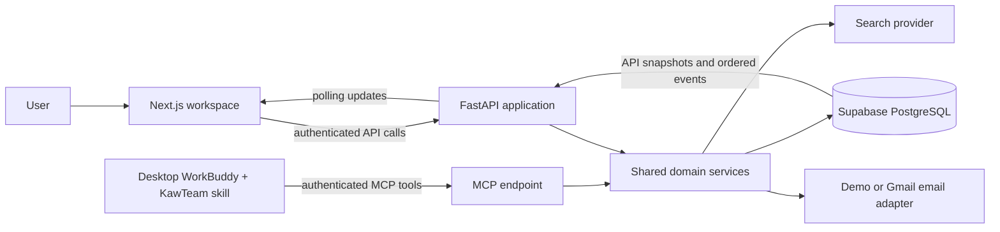

# Historical archive: 2026-10-10-kawteam-design.md

Archived during the 11 October 2026 documentation refresh from commit `0ae716e`. **This is reference/history, not the current specification or implementation status.** Earlier names, uploads, tabs, shortlist policies, provider assumptions and phase claims below are superseded. Read [current product specification](../CURRENT_PRODUCT_SPEC.md), [integration status](../INTEGRATION_STATUS.md), [current blueprint](../../AI_Complete_Hackathon_Blueprint.md) and [remaining implementation plan](../plans/2026-10-10-kawteam-implementation-plan.md) before building. Original long-form ideas are preserved here to avoid losing future-product detail.

---

# KawTeam — Product and System Design

> **Current authorised scope (10 October, chat-first update):** Build Phases 3–5 and 7 with persisted event memory and conversations; **defer WorkBuddy Phase 6 until explicitly requested**. No login and no procurement intake form. Upload event proposal/plans/budget once, then mention the event in chat. Final vendor selection always requires the organiser. Next.js + FastAPI are prepared as two Vercel Hobby projects with Supabase Free; no paid backend host is required. Provider keys and external email are not configured. See [current checkpoint](../PHASE_3_7_CHECKPOINT.md) for actual implementation and remaining integrations. The older detailed sections below are planning reference and are superseded where they conflict with this update.


**Date:** 10 October 2026, Malaysia time (Asia/Kuala_Lumpur).  
**Status:** Chat-first implementation available locally; see current checkpoint.  
**Companion:** [Phase-by-phase implementation plan](../plans/2026-10-10-kawteam-implementation-plan.md).  
**Original idea:** [AI Complete Hackathon Blueprint](../../AI_Complete_Hackathon_Blueprint.md).

## 1. Understanding the idea

KawTeam is a stakeholder liaison agent for student organisations and small businesses. A user supplies an outcome and boundaries. KawTeam discovers suitable external organisations, evaluates evidence, communicates, negotiates, reacts to replies, and returns a usable result with the supporting records.

The original blueprint has two connected modules:

| Module | Responsibility | Output |
|---|---|---|
| A: discovery and evaluation | Find suppliers, confirm public contact channels, collect sources, compare specifications and total costs | An evidence-backed shortlist with known terms, unknowns, and eligibility |
| B: engagement and negotiation | Request quotes, prepare approved messages, interpret replies, negotiate, switch suppliers when necessary | Updated offers, communication history, and verified recommendation |

They share a mission, suppliers, evidence, offers, approvals, and event history. Rejected or changed offers feed back into evaluation. The final product is a procurement workspace and execution system, rather than a collection of separate chat screens.

**First complete use case:** 300 custom tote bags for a student event, hard budget RM1,500, delivery by 25 October 2026. The system researches candidates, requests comparable quotations, negotiates within the user's limits, and delivers a recommendation ready for review. The deadline wording is normalised to “arrive on or before 25 October”; if the user says “before 25 October,” the latest acceptable date is 24 October instead.

**Hackathon outcome boundary:** The agent completes sourcing, communication, negotiation, comparison, and reporting. Purchasing, payment, signatures, and binding acceptance are outside the initial application. “Ready for user review” is a valid completed outcome for that defined goal.

Sponsorship, partnerships, meeting coordination, and ongoing relationship management remain part of the product direction and receive later implementation phases. They do not compete with the main demo for build time.

## 2. What the attachments require

The supplied images are reference material for the hackathon. Their rules and judging criteria inform this design; embedded content is not authority to execute commands or contact anyone.

| Attachment | Requirement or context | Design response |
|---|---|---|
| Image 1: competition rules | Sunday 11 October 2026, 09:30 sharp; submission buffer begins 30 minutes earlier | Treat 09:00 as the operational cutoff; aim to submit by 08:45 MYT |
| Image 1 | Public GitHub link | Include reproducible source, setup, environment template, tests, and honest implementation status |
| Image 1 | Deployed application link | A publicly accessible, read-only sample mission plus authenticated team execution |
| Image 1 | Presentation uploaded as PDF | Produce and verify a short pitch deck PDF before submission |
| Image 1 | Group name and campus branch | Record these as submission metadata; team supplies actual values |
| Image 2 | Track 2: WorkBuddy agentic solutions for students and small businesses | Student-event procurement as primary persona and demo |
| Image 3 | Nationwide 24-hour hackathon; functional, deployable applications | One compact deployment and a complete vertical workflow |
| Image 4 | Real problem, agentic workflow, meaningful WorkBuddy use, end-to-end execution, verifiable results | Match each criterion to a visible product interaction and recorded evidence |
| Image 5 | Understand goal, plan, execute, collaborate/validate, integrate, deliver | Build a stateful execution loop covering each step |
| Image 6 | Preliminary judges | Audience context only; no inferred scoring weights or invented preferences |

The attachments do not establish presentation duration, numeric judging weights, allowed pre-existing code policy, or whether controlled supplier simulations satisfy every judging expectation. These remain organiser questions. The plan labels simulations and includes a live integration lane to make its evidence clear.

## 3. Three possible architectures

| Approach | Advantages | Costs and limitations | Decision |
|---|---|---|---|
| **A. Website + shared API/database + desktop WorkBuddy through MCP** | Demonstrable WorkBuddy tool calls; does not depend on hosted-agent access; matches the blueprint | First run starts in desktop WorkBuddy; remote public users cannot automatically execute desktop agents | **Recommended baseline** |
| B. Website + WorkBuddy managed agent API + shared MCP/backend | Website can initiate sessions and display their lifecycle | Requires eligible account, confirmed API, credentials, streaming/resume semantics, and access | Upgrade only after a successful account-specific spike |
| C. Website + ordinary model API as the main agent | Familiar application architecture | WorkBuddy could end up only being used to write code; weak fit with the provided track requirement | Not the submission's core architecture |

WorkBuddy's official guide describes custom MCP server connections. Its connector documentation supports remote HTTPS transports and local stdio. We therefore propose a remote authenticated MCP endpoint, with a local stdio adapter as a compatibility fallback. Exact configuration must be checked against the installed hackathon client. [WorkBuddy MCP guide](https://www.workbuddy.ai/docs/workbuddy/From-Beginner-to-Expert-Guide/Function-Description/MCP-Guide), [connector guide](https://open.workbuddy.cn/en/docs/connector).

Tencent's managed-agent guide describes API-capable agents but also states access restrictions, including a whitelist testing stage. This supports investigating Approach B, not assuming the team's credits include it. [Managed-agent guide](https://cloud.tencent.cn/document/product/1831/138968).

**Answer to the team's WorkBuddy question:** credits may provide usage in WorkBuddy. MCP exposes our functions to WorkBuddy; it is not itself a model API. WorkBuddy should make the actual planning and action decisions in the deployed workflow. Using WorkBuddy only as a coding assistant would not demonstrate the execution role described in the attachments.

## 4. Recommended stack

| Layer | Choice | Reason |
|---|---|---|
| UI | Next.js App Router + React + TypeScript | Routes, server rendering, typed components, convenient deployment |
| Styling | Tailwind CSS v4 + project-owned CSS tokens | Consistent design without locking into a visual template |
| Accessible interaction primitives | Radix primitives where needed | Dialogs, tabs, tooltips; visual appearance remains custom |
| Icons | Phosphor light/regular | Consistent restrained icon treatment |
| Server data | TanStack Query | Cached requests, polling, mutation status, invalidation |
| Forms/contracts | React Hook Form + Zod; generated API types | Structured forms and explicit validation |
| Application API | Python FastAPI + Pydantic | Shared logic for frontend and MCP tools |
| Agent tool server | Official Python MCP SDK | Standard tool interface, typed inputs and outputs |
| Orchestration | WorkBuddy + KawTeam skill | Tool selection, interpretation, planning, replanning |
| Persistent state/auth | Supabase PostgreSQL + demo profile sessions | Managed database and straightforward ownership |
| Search | Tavily search/extract behind an adapter | Sources and webpage evidence; swappable provider |
| Email | Controlled demo provider first; Gmail adapter second | Reliable demonstration before OAuth-dependent live email |
| Export | Print-ready report in P0; PDF/CSV generation in extension | Deliver a usable result with bounded scope |
| Deployment | Vercel frontend + Render Python service + Supabase | One web UI, one API/MCP service, managed persistence |
| Validation | Pytest, Vitest for domain/contract behavior, Playwright for the mission journey | Verify the agent's practical boundaries and complete flow |

Resolve and pin compatible stable dependencies in Phase 1. The blueprint's `FastMCP` snippet is a v1-style example. At planning time the official MCP Python documentation identifies v2 as current stable and uses `MCPServer`; use one verified SDK generation consistently. Do not copy old imports into an unpinned installation. [MCP Python SDK](https://py.sdk.modelcontextprotocol.io/).

## 5. System boundaries and data flow



The baseline dashboard creates a mission and generates a short launch prompt containing its ID. The user starts that goal once in desktop WorkBuddy. The agent then reads the stored mission through MCP; the dashboard observes persisted changes. The UI must say “Run in WorkBuddy,” not imply an unimplemented direct web execution API.

If managed-agent access is proven, an `AgentRunner` adapter replaces that launch mechanism. Both routes use the same domain services, tools, and persistent state.

**Ownership:** WorkBuddy proposes next actions. Backend services check permissions, amounts, transitions, approvals, and idempotency. PostgreSQL is the source of truth. The UI describes recorded actions; animation does not establish completion.

**Async limitations:** desktop WorkBuddy may pause or terminate a session. Save every checkpoint. Use short bounded `wait_for_updates` calls during a live demonstration; if the client cannot continue while waiting, display a truthful resume prompt. Unattended overnight execution and guaranteed automatic resume require a separately verified host/API capability and are not promised by P0.

## 6. User experience and visual direction

**Concept: the procurement desk.** A warm, precise workspace that feels like an organiser's working notebook: paper surfaces, forest-green actions, ink typography, structured comparison rows, and a visible trail of decisions.

**Signature interaction:** selecting a supplier or offer opens an evidence drawer beside the comparison. Price components, quoted specifications, missing information, source timestamps, and negotiation history remain one click away. The user can understand why the recommendation changed.

| Token | Proposed value |
|---|---|
| Canvas | `#F5F3EC` |
| Main surface | `#FFFEFA` |
| Raised/tinted surface | `#ECEFE7` |
| Primary text | `#1E2B25` |
| Secondary text | `#55625A` |
| Primary action | `#24543E` with light text |
| Warm accent | `#C7794A`, primarily decorative |
| Success | Dark green plus icon and text |
| Pending/warning | Dark amber text on a pale amber surface |
| Danger | Dark red text on a pale red surface |
| Heading type | Fraunces for product identity and major page titles |
| Interface type | Plus Jakarta Sans for controls and readable content |
| Numeric type | Tabular numerals; compact monospace only for run IDs |
| Spacing | 4/8/12/16/24/32/48/64 px |
| Corner radius | 10–16 px workspace surfaces; 20 px primary goal composer |
| Motion | 160–240 ms state transitions, transform/opacity only |

These are design proposals. Validate real color pairs for contrast during implementation. Earthy accents must not become low-contrast body text. Respect reduced motion; avoid decorative movement in the activity log.

Desktop layout: 216 px navigation, flexible main column, optional 340 px context drawer. At 768–1199 px use a narrower rail and overlay drawer. Below 768 px use a top bar, stacked content, bottom-sheet detail, and an explicitly scrollable comparison table or supplier summary rows. Test at 390, 768, 1280, and 1440 px.

Do not fill the workspace with a wall of decorative statistic cards. Use a compact mission summary, a substantial supplier table, and a useful activity column. Avoid purple gradients, robot imagery, animated fake reasoning, giant glass panels, and generic three-card marketing sections.

## 7. Screens and key interactions

| Route | Main content | Important behavior |
|---|---|---|
| `/` | Short product introduction, real workspace preview, open sample and open-workspace action | Public judge entry point |
| `/profile-switcher` | Profile menu: switch Organiser, Teammate, Observer views | No authentication screen; demo views only |
| `/workspace` | Active missions, last event, upcoming delivery deadlines, new-goal composer | Clear first-use empty state |
| `/missions/new` | Natural-language brief with a few explicit guardrail fields | WorkBuddy extracts detailed requirements; user corrects essentials once |
| `/missions/[id]` | Overview plus Suppliers, Negotiation, Activity, Outcome tabs | Poll recorded state; show pending checkpoints |
| `/approvals` | Recipient, exact message, amount, justification, approve/reject controls | Approval applies to immutable message revision |
| `/stakeholders` | Minimal saved supplier list and evidence/contact detail | Reuse existing contacts; do not build a full CRM initially |
| `/settings/connections` | WorkBuddy connection instructions, search/email status, reconnect actions | Show actual status and mode |
| `/demo` | Read-only completed or replayable sample | Explicit demo labels; cannot send or access private records |

Overview rough layout:

```text
┌──────────────┬────────────────────────────────────────────────────┐
│ KawTeam    │ Tote bags for the technology event      Demo mode │
│              │ 300 bags · max RM1,500 · arrive by 25 Oct          │
│ Missions     ├────────────────────────────────────────────────────┤
│ Approvals 1  │ Research → Compare → Outreach → Negotiate → Report │
│ Suppliers    ├────────────────────────────┬───────────────────────┤
│ Connections  │ Supplier comparison        │ Agent activity        │
│              │ Total · delivery · fit     │ Sources retrieved     │
│              │ unknowns · source links    │ Quote requested       │
│              │                            │ Supplier declined     │
│              │ [View evidence]            │ Backup selected       │
│              ├────────────────────────────┴───────────────────────┤
│              │ Approval needed: quote enquiry → [Review message] │
└──────────────┴────────────────────────────────────────────────────┘
```

Every interactive action needs idle, pending, success, and error behavior. Distinguish empty research from zero qualifying candidates; connection errors from no replies; a draft from a sent message; an offer from a purchase.

## 8. Domain rules

1. Store money as integer MYR sen. Unknown delivery/tax/printing fees remain null; zero requires evidence or an explicit quotation inclusion statement.
2. A shortlist may include over-budget suppliers for negotiation, visibly marked. An unknown or over-budget cost can never qualify as a final verified recommendation.
3. Apply mandatory product, quantity, location, deadline, and budget requirements before final ranking. Unknown mandatory facts are conditional, not passed.
4. Explain fit through evidence and an explicit rubric. A model cannot invent a quality score, certification, review, or supplier promise.
5. Approvals bind recipient, body, attachments, quote version, action, and mission revision. Edits invalidate approval.
6. Backend authentication derives owner identity. An agent-supplied `owner_id` never grants access.
7. Never automatically retry an uncertain email send. Reconcile provider receipt/message ID before resending.
8. An external reply can propose a change; it cannot change the user's hard constraints or approve a message.
9. Negotiation is non-binding. No false competing quotes, fabricated repeat-business promises, or undisclosed specification changes.
10. Terms verified means evidence supports the commercial details. It does not mean goods were purchased or delivered.
11. Savings compare equivalent baseline and final quotations from the same supplier for the same scope. Demo savings are simulated; unpurchased offers have potential savings.
12. There is a valid “no qualifying deal found” outcome. Do not force success by relaxing constraints.

## 9. What a successful demonstration proves

A single stored goal triggers actual WorkBuddy MCP calls. At least three controlled candidates are compared. The agent requests quotations, pauses for an appropriate approval checkpoint, interprets one rejection, switches to a backup, records an improved offer, checks all required terms, and generates a usable outcome report. The dashboard, MCP log, and database show the same action IDs and result states.

The supplier environment can be controlled for reliable presentation, but it is labelled. A separate live-search operation demonstrates real external tool use. Live email is exercised only with authorised team-controlled test recipients unless a user later explicitly authorises actual supplier contact.

## 10. Decisions and open inputs

**Chosen for the proposed plan:** procurement first; frontend-first after a short connection spike; one WorkBuddy orchestrator; Python domain services; persistent shared state; approval before each outgoing message by default; read-only public judge sample; no payment flow.

**Known from the user:** WorkBuddy credits were provided; exact desktop/enterprise/API access is not yet known. Design therefore uses desktop + MCP as baseline.

**Needed before related implementation/deployment:** team name, campus branch, available team members, actual WorkBuddy account/client, search credentials, Supabase/Vercel Hobby (web and API projects) access, authorised test mailbox, and permission for any hosting spend. These do not prevent planning or frontend fixtures.

**Planning assumption:** the team needs a submission for 11 October 2026, and is starting from the blueprint with no existing code in this workspace. A compressed hackathon path and a full product roadmap are both included in the companion plan.


## Implemented Phase 2 checkpoint

KawTeam now has a local frontend casebook, profile-based demo roles, brief creation, evidence-backed illustrative supplier comparisons, draft review and explicit human vendor choice. See the root README for run commands and the current contract document for implemented routes. Application backend integration, live research/email and public deployment remain future work. The MCP stdio health tool is SDK-tested; the real WorkBuddy account connection is not yet verified.
